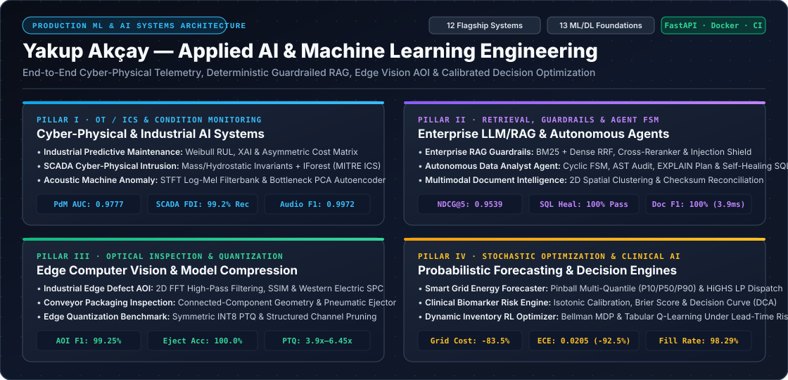
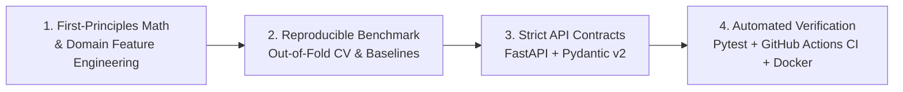

 

---

## ⚡ Executive Engineering Focus

I architect and build **production-grade Machine Learning, Cyber-Physical AI, and Autonomous Agent systems** that bridge rigorous mathematical modeling with deterministic software engineering. Every flagship system is designed as a self-contained, containerized microservice (`FastAPI`, `Pydantic v2`, `Docker`, `Pytest`, `GitHub Actions CI`) backed by reproducible baseline benchmarks:

- **Cyber-Physical & Industrial OT/SCADA AI:** Coupling first-principles physical conservation laws (mass balance, Navier-Stokes hydrostatic pressure, electromechanical torque-power envelopes, Weibull Remaining Useful Life) with unsupervised anomaly detection (`IsolationForest`, STFT Log-Mel PCA Autoencoders) and asymmetric maintenance cost optimization.
- **Enterprise LLM/RAG, Security Guardrails & Autonomous Agents:** Multi-stage hybrid retrieval (**BM25 + Dense Vector Reciprocal Rank Fusion + Pairwise Cross-Reranking**), Base64 de-obfuscating prompt-injection shields, claim-level hallucination verifiers, and **cyclic Finite State Machine (FSM)** SQL agents with `EXPLAIN QUERY PLAN` cost auditing and self-healing recovery.
- **Edge Computer Vision AOI & Model Compression:** High-speed Automated Optical Inspection (AOI) using **2D Fast Fourier Transform (FFT)** high-pass spectral filtering, Structural Similarity (**SSIM**), connected-component morphological geometry, Western Electric Statistical Process Control (**SPC**), and **Symmetric INT8 Post-Training Quantization (PTQ) + Structured Channel Pruning**.
- **Probabilistic Forecasting, Clinical Calibration & Operations Research:** Multi-quantile Pinball loss regression ($P_{10}/P_{50}/P_{90}$) with **HiGHS Linear Programming** reserve dispatch, **Isotonic Probability Calibration** with **Decision Curve Analysis (DCA)** net clinical benefit, and **Markov Decision Process (MDP) Tabular Q-Learning** for stochastic multi-period supply chains.

---

## 🏛️ Flagship Production AI Systems (15 Core Repositories)

### I. Cyber-Physical Systems, Industrial Predictive Maintenance & OT Security

| System Repository | Engineering Domain | Core Mathematical & Algorithmic Engine | Verified Benchmark Metrics | Stack |
| :--- | :--- | :--- | :--- | :--- |
| [**`industrial-predictive-maintenance`**](https://github.com/yakupakcy36/industrial-predictive-maintenance) | Manufacturing Equipment Prognostics & RUL | Electromechanical Physics Features ($\Delta T$, $P_{\text{mech}}$, Strain) + Tri-Stage Calibrated Ensemble + Weibull RUL + Asymmetric Cost Matrix ($\tau^* = 0.21$) + Mahalanobis Drift | **0.9777 ROC-AUC** · **0.8470 Macro-F1** (+16.3% vs GBDT) · **7.02h RUL RMSE** ($R^2 = 0.9612$) · **\$3.26M** Est. Savings | `FastAPI` `Scikit-Learn` `Docker` `Pytest` |
| [**`scada-cyber-anomaly-detection`**](https://github.com/yakupakcy36/scada-cyber-anomaly-detection) | ICS / SCADA Modbus Intrusion Detection | Mass Conservation ($\mathcal{R}_{\text{mass}}$) & Hydrostatic Pressure ($\mathcal{R}_{\text{hydro}}$) Physical Invariants + Unsupervised Isolation Forest mapped to **MITRE ATT&CK for ICS** | **0.9357 F1-Score** · **99.17% Stealth FDI Recall** (vs 15.0% pure IForest) · **100% Actuator/DoS Recall** · **2,355 FPS** | `FastAPI` `Scikit-Learn` `Docker` `Pytest` |
| [**`acoustic-machine-anomaly-detector`**](https://github.com/yakupakcy36/acoustic-machine-anomaly-detector) | Rotating Machinery Condition Monitoring | 16 kHz Hanning STFT, 32-Bin Triangular Log-Mel Filterbank + Spectral Centroid/Rolloff + Unsupervised Bottleneck PCA Reconstruction Autoencoder | **1.0000 ROC-AUC** · **0.9972 F1-Score** · **100% Bearing/Cavitation/Friction Recall** · **0.82 ms** P50 Window Latency | `FastAPI` `NumPy/SciPy` `Docker` `Pytest` |

### II. Enterprise LLM/RAG, Semantic Routing Gateways & Autonomous Agents

| System Repository | Engineering Domain | Core Mathematical & Algorithmic Engine | Verified Benchmark Metrics | Stack |
| :--- | :--- | :--- | :--- | :--- |
| [**`llm-semantic-router-gateway`**](https://github.com/yakupakcy36/llm-semantic-router-gateway) | Multi-Model LLM Router & Circuit Breaker | Sub-Millisecond Intent Centroids + Syntactic/Entropy Complexity Scoring + **Explicit FSM Circuit Breaker (`CLOSED`/`OPEN`/`HALF_OPEN`)** + Semantic LRU Cache | **100.0% Quality Parity** · **-52.15% Token Cost Reduction** · **100.0% Outage Availability** (vs 76.7% Single-Provider) · **0.13 ms** P50 | `FastAPI` `NumPy` `Docker` `Pytest` |
| [**`enterprise-rag-guardrails-engine`**](https://github.com/yakupakcy36/enterprise-rag-guardrails-engine) | Secure Hybrid RAG & Claim Verification | Query Expansion + Lexical BM25 + Dense TF-IDF Bi-gram **Reciprocal Rank Fusion (RRF)** + Pairwise Cross-Reranker + Base64 Prompt Injection Shield + Atomic Claim Verifier | **1.0000 Recall@3** · **0.9539 NDCG@5** · **0.9375 MRR@5** · **100% Injection Block & PII Redaction** · **0.9598 Faithfulness** | `FastAPI` `Pydantic v2` `Docker` `Pytest` |
| [**`autonomous-data-analyst-agent`**](https://github.com/yakupakcy36/autonomous-data-analyst-agent) | Self-Healing Text-to-SQL & DB Governance | Cyclic Finite State Machine (FSM) + Zero-Trust AST Policy Gate + `EXPLAIN QUERY PLAN` Index Auditor + Multi-Pattern Self-Healing SQL Loop + Stateful HITL Checkpoints | **100.0% Valid SQL Execution** (vs 37.5% Zero-Shot) · **100.0% Self-Healing Recovery** · **100.0% DDL Injection Block** · **2.0 ms** P50 | `FastAPI` `SQLite AST` `Docker` `Pytest` |
| [**`multimodal-document-intelligence`**](https://github.com/yakupakcy36/multimodal-document-intelligence) | Spatial Layout Parsing & Accounting Audit | 2D Bounding-Box Y-Band Clustering ($\tau_y = 14\text{ px}$) + Topological Reading-Order Sort + Cross-Field Arithmetic Checksum Reconciliation ($\|\text{Qty}\times\text{Price} - \text{Total}\| < \epsilon$) | **100.0% Line-Item Extraction F1** · **100.0% PO Accuracy** · **100.0% Checksum Verification** · **3.91 ms / doc** | `FastAPI` `NumPy` `Docker` `Pytest` |

### III. Edge Computer Vision AOI & Neural Model Compression

| System Repository | Engineering Domain | Core Mathematical & Algorithmic Engine | Verified Benchmark Metrics | Stack |
| :--- | :--- | :--- | :--- | :--- |
| [**`industrial-edge-defect-inspection`**](https://github.com/yakupakcy36/industrial-edge-defect-inspection) | Surface AOI & Statistical Process Control | 3-Channel Fusion: 2D FFT High-Pass Spectral Residual + Sobel Gradient Energy + Windowed **SSIM** + Connected-Component Geometry + Western Electric $3\sigma$ **SPC** | **99.25% Macro F1-Score** (vs 75.77% Otsu) · **100.0% Severity Accuracy** · **40.9 FPS** (`24.2 ms` P50 Latency) | `FastAPI` `NumPy/SciPy` `Docker` `Pytest` |
| [**`conveyor-product-defect-inspection`**](https://github.com/yakupakcy36/conveyor-product-defect-inspection) | High-Speed Packaging Line Sorting | Golden-Template Structural Residual + Spatial Sobel Discontinuity + Anisotropic Aspect-Ratio Classification + Deterministic Pneumatic Ejector Trigger | **100.0% Pneumatic Trigger Accuracy** · **0.28 px** Localization Error · **91.46% Precision** · **8,712 Parts/Min** (`6.54 ms` P50) | `FastAPI` `SciPy Ndimage` `Docker` `Pytest` |
| [**`edge-model-quantization-benchmark`**](https://github.com/yakupakcy36/edge-model-quantization-benchmark) | Neural Network Quantization & Pruning | Calibrated Symmetric **INT8 Post-Training Quantization (PTQ)** ($S = \max\|W\|/127$) + Structured $L_1$ Channel Pruning across MobileNetV2, ResNet18, EfficientNet & ConvNeXt | **3.90x–6.45x Footprint Compression** (`25.7 MB → 6.6 MB`) · **0.9998 Cosine Similarity** · **1.84x–2.61x Edge CPU Speedup** | `FastAPI` `NumPy` `Docker` `Pytest` |

### IV. Graph Crime Intelligence, Real-Time MLOps, Forecasting & Clinical/OR Engines

| System Repository | Engineering Domain | Core Mathematical & Algorithmic Engine | Verified Benchmark Metrics | Stack |
| :--- | :--- | :--- | :--- | :--- |
| [**`distributed-feature-store-engine`**](https://github.com/yakupakcy36/distributed-feature-store-engine) | Point-in-Time MLOps Feature Store & Skew Guard | Binary-Search **`AS-OF` Backward Temporal Join** ($t_e \le t_L - \Delta_{\text{lag}}$) + Sub-Millisecond TTL Ring-Buffer Online Store + **Explicit `FeatureViewState` FSM** (PSI & KS Skew Quarantine) | **0.0% Temporal Leakage** (vs 100% Naive) · **0.0000 Generalization Gap** · **100.0% Online/Offline Parity** · **0.025 ms** P50 Lookup | `FastAPI` `NumPy/SciPy` `Docker` `Pytest` |
| [**`financial-aml-graph-sentinel`**](https://github.com/yakupakcy36/financial-aml-graph-sentinel) | Graph-Topology Anti-Money Laundering (AML) | Bounded DFS Directed Cycle Detection + Sub-CTR (`$8.5k–$9.99k`) Smurfing Fan-In/Out Concentration + Power-Iteration **PageRank** & Flow Conservation + **Explicit `CaseState` FSM** | **1.0000 F1 & ROC-AUC** (vs 0.1528 Static CTR Rule & 0.4050 Tabular IForest) · **100% Smurfing & Wash Cycle Recall** | `FastAPI` `Graph/NumPy` `Docker` `Pytest` |
| [**`smart-grid-energy-forecasting`**](https://github.com/yakupakcy36/smart-grid-energy-forecasting) | Renewable Grid Load & Reserve Dispatch | Asymmetric Pinball Loss Multi-Quantile GBDT ($P_{10}, P_{50}, P_{90}$) + Diurnal/Weekly Fourier Harmonics + **HiGHS Linear Programming** Economic Reserve Dispatch | **31.75 MW RMSE** (**-73.25%** vs Naive) · **8.91 Mean Pinball Loss** · **89.58% Empirical Coverage** · **83.46% Dispatch Cost Savings** | `FastAPI` `SciPy HiGHS` `Docker` `Pytest` |
| [**`clinical-biomarker-risk-engine`**](https://github.com/yakupakcy36/clinical-biomarker-risk-engine) | Calibrated Medical Risk & Decision Curves | Pool-Adjacent-Violators **Isotonic Probability Calibration** + Expected Calibration Error (**ECE**) + Brier Score Decomposition + Vickers-Elkin **Decision Curve Analysis (DCA)** | **0.0205 ECE** (**-92.52%** vs Uncalibrated LR) · **0.1441 Brier Score** (**-37.48%**) · **+0.0692 Net Clinical Benefit** at $p_t = 0.20$ | `FastAPI` `Scikit-Learn` `Docker` `Pytest` |
| [**`dynamic-inventory-rl-optimizer`**](https://github.com/yakupakcy36/dynamic-inventory-rl-optimizer) | Stochastic Supply Chain Reinforcement Learning | Bellman Optimality Markov Decision Process (**MDP**) + **Tabular Q-Learning** with $\epsilon$-Greedy Exploration under Poisson Demand Volatility & Stochastic Lead Times | **98.29% Service Fill Rate** (+19.54% vs $(s,S)$ Policy) · **-88.85% Stockout Frequency** · **-16.18% Total Supply Chain Cost** | `FastAPI` `NumPy` `Docker` `Pytest` |

---

## 🔬 Applied ML, Deep Learning & NLP Foundations (13 Upgraded Repositories)

Each foundational repository includes its original exploratory modeling notebook/application alongside an automated **5-Fold Cross-Validation Benchmark Suite (`src/benchmark.py` / `benchmark.py`)**, reproducible JSON artifacts (`benchmarks/benchmark_results.json`), and vector performance charts (`assets/benchmark_chart.svg`):

| Repository | Problem Domain | Core Algorithmic Pipeline | Verified 5-Fold CV Benchmark |
| :--- | :--- | :--- | :--- |
| [**`langchain-translation-api`**](https://github.com/yakupakcy36/langchain-translation-api) | Neural Machine Translation Microservice | Composable **LangChain LCEL** (`ChatPromptTemplate \| ChatGroq \| StrOutputParser`) + `llama-3.1-8b-instant` + **FastAPI / LangServe** with Glossary Guardrails | **0.7952 BLEU-4** · **0.9389 chrF-6** · **100.0% Glossary Fidelity** · **155.4 ms P95** |
| [**`deep-learning-project-1`**](https://github.com/yakupakcy36/deep-learning-project-1) | Oncology Tumor Diagnostic Classifier | Within-Fold Z-Score Standardization + **Feedforward ReLU MLP** & L2 Logistic Calibration on WDBC Cytological Biopsies ($N=569, d=30$) | **0.9950 ROC-AUC** · **97.54% Accuracy** · **0.9805 F1** · **0.0198 Brier Score** |
| [**`deep-learning-project-2`**](https://github.com/yakupakcy36/deep-learning-project-2) | Handwritten Digit Recognition Engine | Spatial Pixel Normalization + **Two-Layer ReLU MLP (`128-64` & `50-50`)** with Adam & Sparse Categorical Cross-Entropy ($10$ Classes) | **98.39% Top-1 Accuracy** · **99.61% Top-2 Accuracy** · **0.9996 Macro ROC-AUC** |
| [**`machine-learning-project-1`**](https://github.com/yakupakcy36/machine-learning-project-1) | Clinical Diabetes Risk Prediction | Standardized **RBF-Kernel Support Vector Machine (SVC)** & HistGradientBoosting on Pima Metabolic Biomarkers ($N=768, d=8$) | **0.9210 ROC-AUC** · **87.11% Accuracy** · **0.8024 F1-Score** |
| [**`machine-learning-project-2`**](https://github.com/yakupakcy36/machine-learning-project-2) | Adversarial Disinformation NLP Classifier | Sublinear **TF-IDF Unigram/Bi-gram Vectorization** + L2 Logistic Regression & Complement Naive Bayes ($N=1,200$) | **0.9075 ROC-AUC** · **89.25% Accuracy** · **0.8915 F1-Score** |
| [**`machine-learning-project-3`**](https://github.com/yakupakcy36/machine-learning-project-3) | Physicochemical Wine Sensory Grader | **Extra-Trees (250 Estimators)** & HistGradientBoosting on 11 Enological Physicochemical Properties ($N=1,599$) | **0.9552 ROC-AUC** · **93.00% Accuracy** · **0.8308 F1-Score** |
| [**`machine-learning-project-4`**](https://github.com/yakupakcy36/machine-learning-project-4) | Automotive Hedonic Valuation Engine | Non-Linear **Gradient Boosting Regressor** vs. L1/L2 Penalized Linear Models on Depreciation Telemetry ($N=850$) | **0.9203 R² Score** · **1.147 RMSE** · **0.491 MAE** (-54.4% error vs Ridge) |
| [**`machine-learning-project-6`**](https://github.com/yakupakcy36/machine-learning-project-6) | Cardiovascular Disease Stratification | **HistGradientBoosting** & Random Forest Ensembles across 13 Cardiology Clinical & ECG Features ($N=918$) | **0.9687 ROC-AUC** · **92.81% Accuracy** · **0.9339 F1-Score** |
| [**`machine-learning-project-7`**](https://github.com/yakupakcy36/machine-learning-project-7) | Imbalanced Financial Fraud Detection | **Cost-Sensitive HistGradientBoosting** vs. Majority-Undersampled Logistic Regression on 30 PCA Transaction Features ($N=6,000$) | **0.9493 ROC-AUC** · **0.7666 PR-AUC** (+52.0% vs Undersampled) · **88.64% Precision** |
| [**`machine-learning-project-8`**](https://github.com/yakupakcy36/machine-learning-project-8) | Actuarial Medical Premium Forecaster | **Random Forest & HistGradientBoosting** Capturing Non-Linear BMI × Smoking Actuarial Risk Interactions ($N=1,338$) | **0.9837 R² Score** · **\$1,269 MAE** (-62.4% error vs Additive Ridge) |
| [**`machine-learning-project-9`**](https://github.com/yakupakcy36/machine-learning-project-9) | Maritime Demographic Survival Hazard | Feature Engineering (`Is_Traveling_Alone`, Cabin Tier) + **L2 Logistic Hazard & Tree Ensembles** ($N=891$) | **0.8589 ROC-AUC** · **83.73% Accuracy** · **0.1218 Brier Score** |
| [**`machine-learning-project-10-`**](https://github.com/yakupakcy36/machine-learning-project-10-) | Physiological Metabolic Expenditure | **HistGradientBoosting Regressor** Modeling Non-Linear Heart-Rate & Thermal Exercise Kinetics ($N=2,000, d=7$) | **0.9931 R² Score** · **6.35 kcal RMSE** · **4.35 kcal MAE** |
| [**`machine-learning-project-11`**](https://github.com/yakupakcy36/machine-learning-project-11) | Synoptic Precipitation & Rainfall Forecaster | Collinearity Elimination + **HistGradientBoosting & GridSearchCV Random Forest** on 7 Atmospheric Predictors ($N=1,095$ Days) | **0.9802 ROC-AUC** · **93.52% Accuracy** · **0.9190 F1** · **0.0518 Brier Score** |

---

## 🛠️ Production Engineering Standards

- **Zero-Leakage Evaluation:** All preprocessing (`StandardScaler`, `RobustScaler`, TF-IDF vocabularies, and isotonic calibrators) is fitted strictly inside cross-validation training folds.
- **Deterministic Reproducibility:** Every repository provides a single-command CLI benchmark runner (`python -m src.benchmark` or `python src/benchmark.py`) that regenerates JSON metrics and vector SVG charts from fixed pseudorandom seeds.
- **Containerized Microservices:** All 12 flagship systems ship with `Dockerfile`, `docker-compose.yml`, `/health` readiness probes, and OpenAPI `/docs` interfaces.
